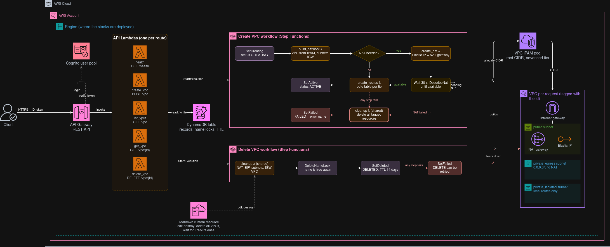
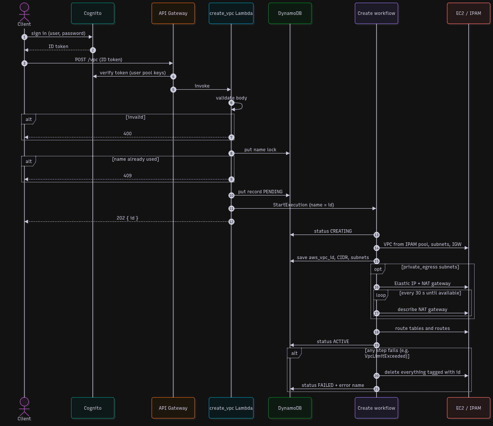
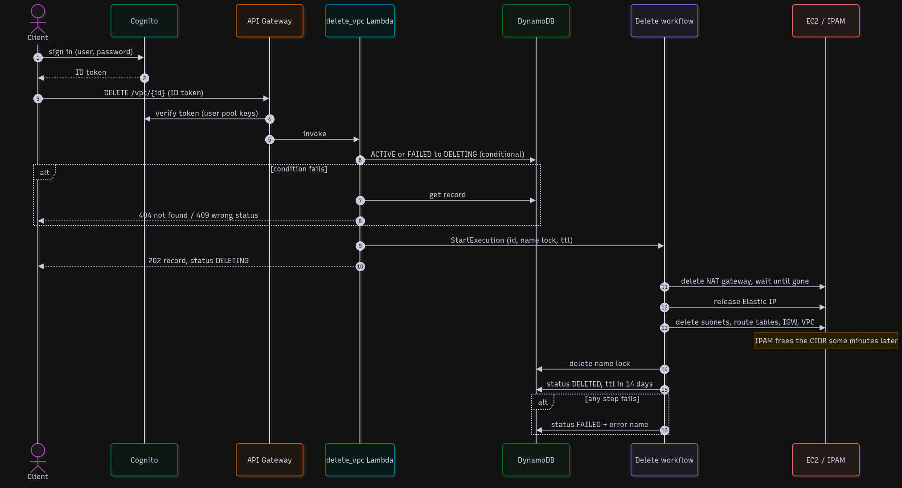

# VPC Provisioning API

A serverless, authenticated REST API that creates Amazon VPCs with multiple subnets, stores the results and exposes them for retrieval.

Built in Python on AWS Lambda, API Gateway, Step Functions, DynamoDB, Cognito and VPC IP Address Manager (IPAM), and deployed end to end with the AWS CDK.

## Scope

In scope:

- Create a VPC with up to 200 subnets, each in one of three tiers: public, private with egress (NAT), private isolated. The VPC CIDR is split equally between the subnets.
- Non-overlapping address space across all API-created VPCs, managed by IPAM.
- One AWS account and one Region: VPCs are created in the Region the stack is deployed to.
- Asynchronous creation with status tracking; retrieve one VPC or list all.
- Delete a VPC created by the API.
- Authentication with Amazon Cognito; every authenticated user is authorized for every operation.
- Fully automated deploy and teardown, including removal of every VPC the API created.

Out of scope:

- Cross-account provisioning (no assumed roles).
- Modifying an existing VPC (resize, add subnets).
- IPv6, VPC peering, Transit Gateway, VPC endpoints, NACL or security group management.
- Fine-grained authorization (per-user or per-team permissions).

## Architecture



Everything runs in one AWS account and one Region, split over two CDK stacks.

`FoundationStack` holds the long-lived parts: the Cognito user pool, the DynamoDB table and the IPAM pool. The table is on-demand and keeps one record per VPC, the name locks that keep names unique, and a `ttl` attribute that clears deleted VPCs after 14 days. The IPAM pool hands out the VPC CIDRs from one root range, `10.0.0.0/8` unless `IPAM_ROOT_CIDR` says otherwise. It runs on the advanced tier, because the free tier can't manage private IPv4.

`ApiStack` holds the code. API Gateway sits in front, with a Cognito authorizer on every route, and each route has its own Lambda. Behind them are two Step Functions workflows, one to build a VPC and one to tear it down. Their steps are either small Lambdas that call EC2, or direct DynamoDB writes from the state machine. A single `cleanup` Lambda deletes everything carrying a request's tag. Both workflows use it: create calls it when a step fails, delete calls it as its first step.

All Lambdas run Python 3.14 on ARM with 128 MB, share one code asset, and get their own IAM role and log group with only the permissions they use.

Each VPC the API builds gets its CIDR from the pool and is tagged with the request id, like every resource inside it. Subnets are spread over the Availability Zones. A public subnet brings an internet gateway. A `private_egress` subnet brings one NAT gateway with an Elastic IP, placed in the first public subnet. Each tier gets its own route table.

`cdk destroy` doesn't leave VPCs behind. A custom resource in `ApiStack` runs the same `cleanup` Lambda over every API-created VPC, then waits for IPAM to release their CIDRs before the stacks go away.

## Business Flow

Creating and deleting a VPC both take minutes, so neither happens inside the API call. The API checks the request, writes a record to DynamoDB and starts a Step Functions workflow, then answers right away with an id for the request. The client uses that id from then on and polls `GET /vpc/{id}` until the status settles. The AWS VPC id (`vpc-…`) only exists later and shows up on the record as `aws_vpc_id`.

Every call needs an ID token. The client gets it by signing in to Cognito, and API Gateway checks it against the user pool before any Lambda runs.

### Create



`POST /vpc` checks the body, then reserves the name in DynamoDB. A second request with the same name returns a 409. The record starts as `PENDING`, and the client gets a 202 with the created id.

The workflow sets the status to `CREATING` and builds the VPC: a CIDR from the IPAM pool, the subnets spread over the Availability Zones, and an internet gateway if the request has a public subnet. When a subnet is `private_egress`, it adds an Elastic IP and a NAT gateway, then checks every 30 seconds until the NAT gateway is up. Last come one route table per tier and the status `ACTIVE`.

If any step fails, the workflow deletes everything it tagged with the request id and marks the VPC `FAILED`, with the AWS error name in `status_reason`. Nothing is left running, and the failed VPC can still be deleted to free its name.

### Delete



`DELETE /vpc/{id}` only accepts a VPC that is `ACTIVE` or `FAILED`. One conditional write moves it to `DELETING`, so two delete requests can't both start a workflow. An unknown id gets a 404, any other status a 409.

The workflow removes the NAT gateway first and waits until it is gone, because it holds the Elastic IP and a network interface in one of the subnets. Then it releases the Elastic IP and deletes the subnets, route tables, internet gateway and the VPC. IPAM hands the CIDR back to the pool on its own some time later; we have seen anything up to about 45 minutes. Finally the name is freed and the record is marked `DELETED`. It stays readable for 14 days, then DynamoDB removes it.

If the teardown fails, the record goes to `FAILED` with the error name, and the delete can be sent again.

## Architectural Decisions

| #   | Topic                       | Decision                                                                | Details                                                 |
| --- | --------------------------- | ----------------------------------------------------------------------- | ------------------------------------------------------- |
| 001 | Infrastructure as code tool | AWS CDK: no state backend to set up, target account unknown             | [ADR-001](docs/adr/001-infrastructure-as-code-tool.md)  |
| 002 | Authentication mechanism    | Amazon Cognito: no custom auth logic, focus stays on the VPC API        | [ADR-002](docs/adr/002-authentication-mechanism.md)     |
| 003 | VPC creation flow           | Step Functions with wait steps for slow resources such as NAT gateways  | [ADR-003](docs/adr/003-vpc-creation-flow.md)            |
| 004 | IP address allocator        | Hybrid: IPAM allocates the CIDR, DynamoDB caches it for retrieval       | [ADR-004](docs/adr/004-ip-address-allocator.md)         |
| 005 | Lambda code layout          | One source tree, one module per function, shared code alongside         | [ADR-005](docs/adr/005-lambda-code-layout.md)           |
| 006 | Duplicate request handling  | Unique VPC name: a second request with the same name gets a 409         | [ADR-006](docs/adr/006-duplicate-request-handling.md)   |
| 007 | Single Region               | VPCs are created in the deployed Region only, IPAM pools are per Region | [ADR-007](docs/adr/007-single-region.md)                |
| 008 | VPC record lifecycle        | API-created id and statuses, `DELETED` record kept for 14 days          | [ADR-008](docs/adr/008-vpc-record-lifecycle.md)         |
| 009 | Failure handling            | Automatic rollback by tag with one shared cleanup Lambda                | [ADR-009](docs/adr/009-failure-handling-and-cleanup.md) |
| 010 | Request validation          | Standard library checks, account limits left to the workflow            | [ADR-010](docs/adr/010-request-validation.md)           |
| 011 | Stack teardown              | `cdk destroy` deletes all API-created VPCs and waits for IPAM           | [ADR-011](docs/adr/011-stack-teardown.md)               |

## Repository layout

- `app.py`: the CDK app. Reads `IPAM_ROOT_CIDR` and the test user settings from the environment.
- `infra/`: the two stacks, `foundation_stack.py` and `api_stack.py`, with their constructs in `infra/constructs/`.
- `lambda/api/`: one handler per API route.
- `lambda/workflow/`: the Step Functions steps and the shared `cleanup` function.
- `lambda/common/`: code shared by the handlers.
- `docs/`: the ADRs, the diagrams and the payload examples.

## How to run

### Prerequisites

- [AWS CDK CLI](https://docs.aws.amazon.com/cdk/v2/guide/getting-started.html) (`npm install -g aws-cdk`, needs Node.js).
- [uv](https://docs.astral.sh/uv/) to manage Python and the dependencies.
- [AWS CLI](https://docs.aws.amazon.com/cli/latest/userguide/getting-started-install.html), used below to read the stack outputs.
- [jq](https://jqlang.org/) to pull the token out of the Cognito login response.
- An AWS account to deploy to, with credentials configured for the CLI (`aws configure` or SSO).

### Deploy permissions

`cdk bootstrap` needs admin-level rights, since it creates the S3 bucket, ECR repository and IAM roles the CDK deploys through. After that, `cdk deploy` only has to assume those bootstrap roles: CloudFormation creates the resources with the bootstrap execution role, which has `AdministratorAccess` by default. If you narrow that role, it must be able to create:

- IAM roles and policies: one role per Lambda, plus the roles of the state machines and the custom resources.
- Lambda functions and their CloudWatch log groups.
- An API Gateway REST API with a Cognito authorizer.
- A Cognito user pool, an app client and the test user.
- A DynamoDB table with TTL.
- Step Functions state machines.
- A VPC IPAM in the advanced tier, and an IPAM pool with a provisioned CIDR.
- CloudFormation custom resources: the test user's password and the teardown.

### Deploy

```shell
uv sync

# the Region to deploy to; every command below uses it
export AWS_REGION=us-east-1

# once per account and Region
cdk bootstrap

cdk deploy --all
```

The IPAM pool that hands out VPC CIDRs defaults to `10.0.0.0/8`. To use another range, set the `IPAM_ROOT_CIDR` environment variable on deploy: `IPAM_ROOT_CIDR=172.16.0.0/12 cdk deploy --all`. IPAM runs in the advanced tier, which is billed per active IP address.

The deploy prints two outputs that the next section needs: `ApiStack.ApiBaseUrl` and `FoundationStack.UserPoolClientId`.

To remove everything, run `cdk destroy --all`. It first deletes every VPC the API created, with its NAT gateways, Elastic IPs and other resources. IPAM releases the CIDRs of deleted VPCs only after a while (up to about 30 minutes), and the IPAM pool cannot be deleted before that, so the destroy waits for it, checking once a minute for up to 55 minutes. If it runs out of time, `ApiStack` ends in `DELETE_FAILED`; run `cdk destroy --all` again later.

### Sign in and call the API

The Foundation stack creates a test user and sets its password during the deploy, so no extra command is needed. The defaults are username `testuser`, email `testuser@example.com` and password `MySecurePassword123!`. They are public in this repo, so override them for any shared or long-lived deployment with `TEST_USER_NAME`, `TEST_USER_EMAIL` and `TEST_USER_PASSWORD`, for example `TEST_USER_PASSWORD='<your password>' cdk deploy --all`. The password needs at least 17 characters with upper and lower case letters, a digit and a symbol. Use the same values in `COGNITO_USER` and `COGNITO_PASSWORD` below.

In the same shell, so `AWS_REGION` is still set, read the stack outputs:

```shell
CLIENT_ID=$(aws cloudformation describe-stacks --region "$AWS_REGION" --stack-name FoundationStack \
  --query "Stacks[0].Outputs[?OutputKey=='UserPoolClientId'].OutputValue" --output text)
API_BASE_URL=$(aws cloudformation describe-stacks --region "$AWS_REGION" --stack-name ApiStack \
  --query "Stacks[0].Outputs[?OutputKey=='ApiBaseUrl'].OutputValue" --output text)
```

Log in against the Cognito API with curl. The API expects the ID token, which is valid for one hour:

```shell
COGNITO_USER='testuser@example.com'
COGNITO_PASSWORD='MySecurePassword123!'

TOKEN=$(jq -n --arg client "$CLIENT_ID" --arg user "$COGNITO_USER" --arg pass "$COGNITO_PASSWORD" \
  '{AuthFlow: "USER_PASSWORD_AUTH", ClientId: $client, AuthParameters: {USERNAME: $user, PASSWORD: $pass}}' \
  | curl -s -X POST "https://cognito-idp.${AWS_REGION}.amazonaws.com/" \
    -H "Content-Type: application/x-amz-json-1.1" \
    -H "X-Amz-Target: AWSCognitoIdentityProviderService.InitiateAuth" \
    -d @- \
  | jq -r .AuthenticationResult.IdToken)
```

Send the token in the `Authorization` header.

```shell
# health check
curl -s "${API_BASE_URL}/health" -H "Authorization: ${TOKEN}"

# create a VPC
curl -s -X POST "${API_BASE_URL}/vpc" \
  -H "Authorization: ${TOKEN}" -H "Content-Type: application/json" \
  -d '{
    "vpc_name": "dev",
    "vpc_prefix": 20,
    "subnet_tiers": ["public", "private_egress", "private_isolated"]
  }'

# list all VPCs
curl -s "${API_BASE_URL}/vpc" -H "Authorization: ${TOKEN}"

# get one VPC and its status (PENDING, CREATING, ACTIVE, FAILED, DELETING, DELETED)
curl -s "${API_BASE_URL}/vpc/<id>" -H "Authorization: ${TOKEN}"

# delete a VPC (only when ACTIVE or FAILED)
curl -s -X DELETE "${API_BASE_URL}/vpc/<id>" -H "Authorization: ${TOKEN}"
```

`subnet_tiers` takes `public`, `private_egress` (NAT) or `private_isolated`, one entry per subnet, at most 200. `vpc_prefix` goes from 16 to 28. The VPC CIDR is split equally between the subnets, so three subnets in a `/20` become three `/22` networks.

AWS allows 5 VPCs per Region by default, and the default VPC already takes one. In a fresh account about four creates go through; the next ones end `FAILED` with `status_reason` `VpcLimitExceeded`. Ask for a higher quota in Service Quotas if you need more.

More request bodies, valid and invalid, are in [docs/payload_examples](docs/payload_examples/README.md). Send one with `curl -d @docs/payload_examples/valid-three-tiers.json`.
